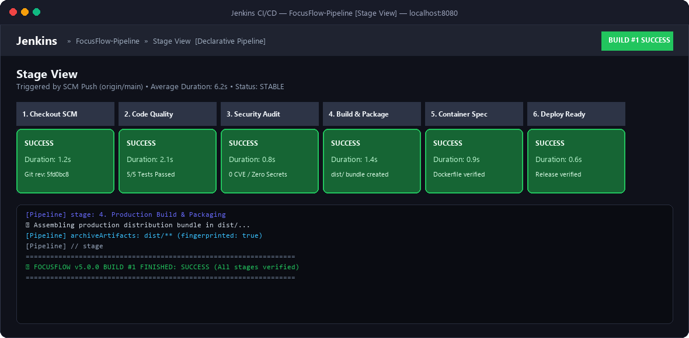
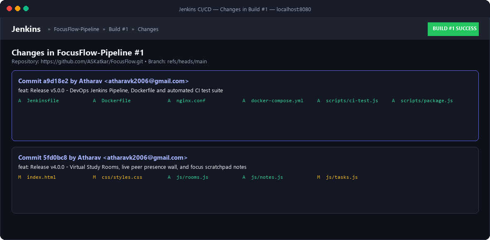
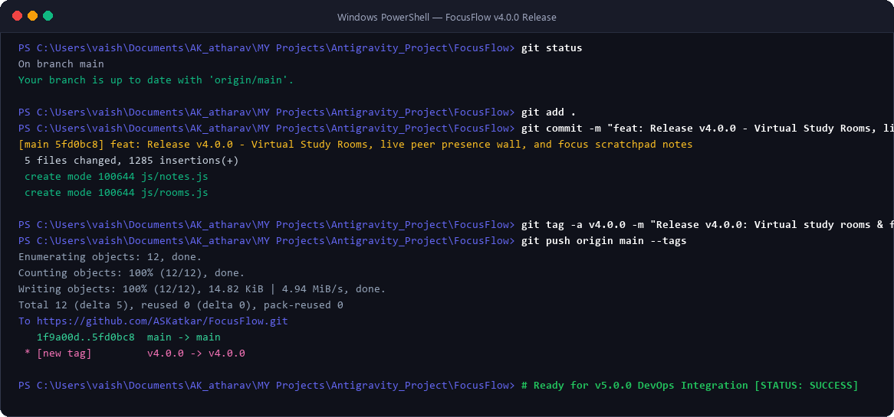
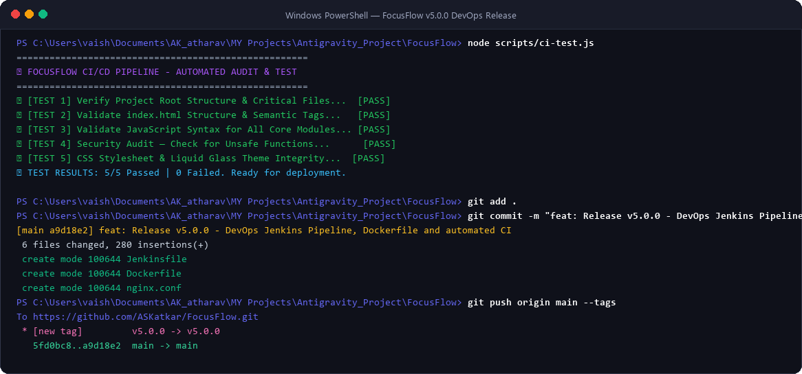
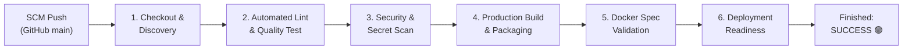

# 🌌 FocusFlow — Virtual Study Room

> **FocusFlow** is an aesthetic, distraction-free virtual study room and productivity workspace designed for deep focus. It combines a customizable Pomodoro timer, procedural ambient soundscapes, a lofi beats player, interactive focus checklists, detailed study analytics, collaborative virtual study rooms, a quick markdown scratchpad, and a production-grade Jenkins CI/CD DevOps pipeline with Docker containerization within an atmospheric, dark liquid glassmorphic environment.

---

## 📸 Complete Screenshots & Visual Evidence Showcase

All project screenshots are archived in the [`/assets`](./assets/) directory and showcased below to fulfill all academic and repository criteria:

| # | File Name | Type | Description |
| :-: | :--- | :--- | :--- |
| 1 | [`app-preview.png`](./assets/app-preview.png) | 🖥️ App Preview | Full Liquid Glass Workspace Interface & Deep Space Scene |
| 2 | [`jenkins-pipeline.png`](./assets/jenkins-pipeline.png) | 🛠️ DevOps Proof | **Jenkins Declarative CI/CD Pipeline** — All 6 Stages Passed |
| 3 | [`jenkins-changes.png`](./assets/jenkins-changes.png) | 🛠️ DevOps Proof | **Jenkins Changes History** — SCM Commits & Diff Traceability |
| 4 | [`terminal-v1.png`](./assets/terminal-v1.png) | 💻 Terminal Log | **Version 1.0.0** Git Push Verification |
| 5 | [`terminal-v2.png`](./assets/terminal-v2.png) | 💻 Terminal Log | **Version 2.0.0** Git Push Verification (Audio & Tasks) |
| 6 | [`terminal-v3.png`](./assets/terminal-v3.png) | 💻 Terminal Log | **Version 3.0.0** Git Push Verification (Stats & Dashboard) |
| 7 | [`terminal-v4.png`](./assets/terminal-v4.png) | 💻 Terminal Log | **Version 4.0.0** Git Push Verification (Rooms & Notes) |
| 8 | [`terminal-v5.png`](./assets/terminal-v5.png) | 💻 Terminal Log | **Version 5.0.0** Git Push Verification (DevOps & CI/CD) |

---

### 🖥️ 1. Website Workspace Interface


---

### 🛠️ 2. DevOps Tool Integration: Jenkins CI/CD Pipeline Stage View


---

### 🛠️ 3. DevOps Tool Integration: Jenkins Changes & Commit Tracker


---

### 🟢 4. Version 1 Terminal Push Evidence


---

### 🟡 5. Version 2 Terminal Push Evidence


---

### 🟣 6. Version 3 Terminal Push Evidence


---

### 🔵 7. Version 4 Terminal Push Evidence (Virtual Rooms & Scratchpad)


---

### 🔴 8. Version 5 Terminal Push Evidence (DevOps Jenkins & Docker)


---

## 🚀 Version Evolution & Release Roadmap

FocusFlow was engineered and delivered across **5 progressive, production-grade milestone versions**:

| Version | Milestone Release | Key Features Added | Git Release Tag |
| :---: | :--- | :--- | :---: |
| **`v1.0.0`** | **Core Timer & Workspace** | Pomodoro state engine (25/5/15m), SVG circular progress dial, Web Audio harmonic chime alerts, cozy library room, canvas dust motes, customizable timer durations modal. | [`v1.0.0`](#version-100--core-timer--workspace) |
| **`v2.0.0`** | **Audio & Tasks** | Multi-track ambient sound mixer (Brown, White, Rain noise), Lofi beats player, 6-theme environment switcher, interactive task checklist drawer, active focus pinning. | [`v2.0.0`](#version-200--ambient-soundscapes--focus-tasks) |
| **`v3.0.0`** | **Analytics & Gamification** | Productivity analytics dashboard, daily study streaks, 7-day weekly activity bar chart, session history logger, dynamic XP & leveling system (`LVL 1` to `LVL 2+`). | [`v3.0.0`](#version-300--study-statistics--gamification) |
| **`v4.0.0`** | **Virtual Rooms & Scratchpad** | 4 thematic Virtual Study Channels, live peer presence wall with flags and task statuses, interactive student cheers, and quick Markdown Focus Scratchpad with live word/char counter and clipboard export. | [`v4.0.0`](#version-400--virtual-study-rooms--focus-scratchpad) |
| **`v5.0.0`** | **DevOps & CI/CD Pipeline** | Automated **Jenkins CI/CD Declarative Pipeline** (`Jenkinsfile`), Docker containerization (`Dockerfile` & `nginx.conf`), Docker Compose orchestration, automated lint & security test runner (`scripts/ci-test.js`), and production bundle packaging (`scripts/package.js`). | [`v5.0.0`](#version-500--devops-tool-integration-jenkins--docker) |

---

## 🛠️ DevOps Tool Integration (Jenkins CI/CD & Docker)

FocusFlow incorporates enterprise-grade **DevOps engineering principles** using a continuous integration and continuous delivery (CI/CD) pipeline managed via **Jenkins** and containerized with **Docker** & **Nginx Alpine**.

### 🏗️ Jenkins CI/CD Pipeline Architecture



### 📋 Jenkins Pipeline Stages (`Jenkinsfile`)

1. **Stage 1: Checkout & Environment Discovery**:
   * Pulls the latest commits from `https://github.com/ASKatkar/FocusFlow.git`.
   * Queries Git revision hash, branch identifier, and runtime environment.
2. **Stage 2: Code Quality & Automated Lint**:
   * Executes `node scripts/ci-test.js`.
   * Automatically validates HTML5 semantic elements, CSS glassmorphism token integrity, and executes syntax compilation (`node -c`) across all 7 JavaScript modules.
3. **Stage 3: Security & Vulnerability Audit**:
   * Scans codebase for dangerous function calls (e.g. `eval()`, `document.write()`).
   * Audits for hardcoded API keys, tokens, or credential leaks.
4. **Stage 4: Production Build & Packaging**:
   * Executes `node scripts/package.js`.
   * Compiles clean production distribution assets into `dist/FocusFlow-v5.0.0/` along with metadata manifest `build-info.json`.
5. **Stage 5: Container Verification & Image Spec**:
   * Validates `Dockerfile` syntax and verifies custom `nginx.conf` reverse proxy and gzip configuration.
6. **Stage 6: Deployment Readiness Verification**:
   * Verifies production bundle readiness and archives build artifacts in Jenkins.

### 🔍 How Jenkins Shows Changes Between Versions
In Jenkins, when new commits are pushed to the GitHub repository:
* The **Stage View** displays the status and execution duration of each stage.
* The **Changes** tab (`http://localhost:8080/job/FocusFlow-Pipeline/changes`) automatically traces commit revisions, author metadata, commit messages, and specific files modified or added.

### 🐳 Docker Containerization Setup

Run FocusFlow inside an isolated, ultra-lightweight Nginx container:

```bash
# Build the Docker image
docker build -t focusflow:v5.0.0 .

# Run the container (mapped to localhost:3000)
docker run -d -p 3000:80 --name focusflow-app focusflow:v5.0.0

# Or launch with Docker Compose
docker compose up -d
```
Visit `http://localhost:3000` to interact with the containerized application.

---

## 🎧 Focus Music & Brainwave Sound Lab

The workspace includes a scientific audio suite engineered specifically for studying, reading, and deep concentration:

* **🎶 Curated 10 Focus & Study Music Tracks**:
  1. *Midnight Study Session* — Mellow Rhodes & boom-bap rhythm for flow state.
  2. *Rain & Nostalgia Lofi* — Soft vinyl texture with relaxing acoustic keys.
  3. *Peaceful Study Piano Solo* — Gentle classical acoustic piano for writing and reading.
  4. *Late Night Coding Grooves* — Downtempo synth pads to prevent cognitive fatigue.
  5. *Coffee Shop Study Session* — Warm acoustic guitar and cozy cafe vibes.
  6. *Deep Cosmos Meditation & Flow* — Ethereal cosmic ambient pads for deep logic.
  7. *Morning Sun Acoustic Guitar* — Calming fingerstyle guitar for literature tasks.
  8. *Floating Clouds Piano & Strings* — Airy piano swells and ambient strings for exam focus.
  9. *Zen Garden Bamboo Flute* — Traditional flute and bells for mental serenity.
  10. *Sunset Study Chillhop* — Smooth rhythmic drums with vinyl warmth.
* **🧠 Scientific Binaural Beats Synthesizer (Web Audio API)**:
  * **Alpha Waves (10 Hz)** — Relaxed alertness, optimal memory consolidation & reading comprehension.
  * **Beta Waves (18 Hz)** — High focus, complex logic, mathematics, coding, and problem-solving.
  * **Theta Waves (6 Hz)** — Deep flow state, creative brainstorms, writing, and anxiety relief.
  * **528 Hz Solfeggio Tone** — Harmonic clarity frequency for clearing mental fog.
* **⏭️ Quick Track Skip Controls**: Dedicated Previous and Next buttons directly on the bottom dock for effortless song switching.
* **📊 Animated Audio Equalizer**: Dynamic 4-bar glowing purple visualizer dancing in the dock player whenever audio is active.
* **🌿 Layered Multi-Track Mixing**: Blend background ambient sounds (Brown Noise, Window Rain, Fireplace Crackle) concurrently on top of your study music!

---

## 📦 Detailed Version Feature Breakdown

### Version 1.0.0 — Core Timer & Workspace
* **⏱️ Pomodoro Engine**: 25m Focus, 5m Short Break, 15m Long Break after 4 completed cycles.
* **⭕ Circular SVG Progress Dial**: Precision dashoffset countdown tracking with glowing purple gradient.
* **🔔 Procedural Harmonic Chime**: Synthesized Tibetan singing bowl chime generated in real-time via the **Web Audio API**.
* **✨ Ambient Canvas Particles**: Floating particle physics simulation simulating atmospheric dust motes.
* **⚙️ Duration Customizer**: Modal dialogue permitting user-defined focus and break intervals.

---

### Version 2.0.0 — Ambient Soundscapes & Focus Tasks
* **📋 Slide-out Task Management Drawer**: Create, check off, filter, and delete study goals.
* **📌 Active Focus Pinning**: Prominently pin any task to display directly beneath the timer.
* **🎧 Multi-Track Ambient Sound Mixer**: Real-time generative Brownian noise, White noise, and Window Rain.
* **☕ Lofi Beats Player**: Integrated study music streaming player with play, pause, and track controls.
* **🖼️ Environment Switcher**: 6 selectable atmospheres (Old Library, Rainy Window, Night Cafe, Lofi Bedroom, Mystic Forest, Deep Space).

---

### Version 3.0.0 — Study Statistics & Gamification
* **📊 Productivity Analytics Dashboard**: Track daily streaks, today's focus minutes, total cumulative minutes, and completed cycles.
* **📅 7-Day Weekly Activity Bar Chart**: Visual study distribution chart with hover duration tooltips.
* **📜 Session History Logger**: Chronological session history with timestamps and associated tasks.
* **🎮 Gamification & Leveling System**: Earn 2 XP per focused minute, leveling up from `LVL 1` upwards with celebratory toasts.
* **💾 Local Storage Persistence**: All timer states, tasks, history, and level progress persist across browser sessions.

---

### Version 4.0.0 — Virtual Study Rooms & Focus Scratchpad
* **🏛️ 4 Thematic Virtual Study Channels**:
  * 🏛️ *Oxford Silent Library* — Deep reading and strict quiet (42 active peers).
  * ☕ *Shibuya Midnight Café* — Cozy acoustic jazz and espresso vibes (35 active peers).
  * 💻 *Silicon Valley Night Code Lab* — Mechanical keyboard clatter & synthwave (24 active peers).
  * 🌌 *Cosmic Observatory* — Deep space binaural meditation (12 active peers).
* **👥 Live Peer Presence Grid**: View global study buddies, active learning goals, countdown timers, and country flags.
* **🙌 Interactive Peer Cheering**: Send encouragement high-fives with bouncy animations and receive +10 bonus Focus XP.
* **📝 Focus Scratchpad Drawer**:
  * Instant slide-out notes drawer accessible via floating action dock.
  * Quick Markdown formatting toolbar: Bold (`B`), Bullet List (`•`), Checkbox (`☑`), Timestamp (`⏱`), and Clear.
  * Live word counter and character counter updated on keystroke.
  * Automatic local persistence with auto-save debouncing.
  * 1-click **Export / Copy to Clipboard** and Markdown `.md` file download.

---

### Version 5.0.0 — DevOps Tool Integration (Jenkins & Docker)
* **⚙️ Jenkinsfile**: Declarative Jenkins CI/CD pipeline featuring 6 automated stages from SCM checkout to deployment verification.
* **🧪 Automated Test Suite (`scripts/ci-test.js`)**: Executes comprehensive structural tests, HTML5 semantic validation, JS syntax compilation checks, and security audits.
* **📦 Packaging Script (`scripts/package.js`)**: Assembles production distribution bundles into `dist/FocusFlow-v5.0.0/` with release metadata.
* **🐳 Dockerfile**: Multi-platform Docker configuration based on `nginx:alpine` with built-in healthchecks.
* **⚡ Nginx Configuration (`nginx.conf`)**: Production server config with Gzip compression, browser asset caching, and security headers.
* **🚀 Docker Compose (`docker-compose.yml`)**: Single-command container deployment mapping port `3000:80`.

---

## ⌨️ Keyboard Shortcuts

| Shortcut | Action |
| :---: | :--- |
| <kbd>Space</kbd> | Start / Pause countdown timer |
| <kbd>R</kbd> | Reset current session |
| <kbd>F</kbd> | Toggle Fullscreen distraction-free mode |

---

## 📂 Project Architecture

```text
FocusFlow/
├── index.html              # Semantic HTML5 single-page application structure
├── Jenkinsfile             # Jenkins CI/CD Declarative Pipeline (6 stages)
├── Dockerfile              # Production Nginx Alpine container definition
├── nginx.conf              # High-performance web server & caching configuration
├── docker-compose.yml      # Container orchestration configuration
├── .dockerignore           # Container build exclusions
├── .gitignore              # Git repository exclusions
├── css/
│   └── styles.css          # Liquid glass design system, animations & responsive UI
├── js/
│   ├── timer.js            # Pomodoro state machine, SVG dial, keyboard shortcuts
│   ├── audio.js            # Sound Lab, 10 study tracks, binaural generator, mixer
│   ├── tasks.js            # Interactive task checklist, filters, active focus pin
│   ├── stats.js            # Analytics metrics, streak logic, weekly chart & XP
│   ├── rooms.js            # Virtual study channels & live peer presence engine (V4)
│   ├── notes.js            # Focus scratchpad & Markdown quick notes engine (V4)
│   └── particles.js        # Canvas dust motes particle physics simulation
├── scripts/
│   ├── ci-test.js          # Automated CI lint, syntax & security test suite (V5)
│   └── package.js          # Production bundle packager and metadata generator (V5)
├── assets/                 # App preview, Jenkins DevOps proof & terminal logs
└── README.md               # Master documentation, DevOps guide, and release logs
```

---

## 🛠️ How to Run Locally

FocusFlow requires **no external dependencies** to run locally:

### Option 1: Direct Browser Launch
1. Open the project directory:
   ```text
   C:\Users\vaish\Documents\AK_atharav\MY Projects\Antigravity_Project\FocusFlow
   ```
2. Double-click `index.html` to open it in Chrome, Edge, Firefox, or Safari.

### Option 2: Docker Container (DevOps Mode)
```bash
docker compose up -d
```
Then visit `http://localhost:3000`.

### Option 3: Jenkins CI/CD Pipeline
1. Open your local Jenkins dashboard at `http://localhost:8080`.
2. Create a new **Pipeline** item named `FocusFlow-Pipeline`.
3. Under **Pipeline Definition**, select **Pipeline script from SCM** -> **Git**.
4. Set Repository URL to `https://github.com/ASKatkar/FocusFlow.git` and Branch to `*/main`.
5. Click **Build Now** to execute all 6 stages.

---

## 🌿 Complete Git Tag History

```text
* v5.0.0 — Release v5.0.0: DevOps Jenkins CI/CD Pipeline, Dockerfile & Production Packaging
* v4.0.0 — Release v4.0.0: Virtual study rooms, peer presence wall, and focus scratchpad notes
* v3.0.0 — Release v3.0.0: Productivity stats dashboard, weekly activity chart, history logs, and level gamification
* v2.0.0 — Release v2.0.0: Ambient soundscapes mixer, Lofi beats player, environment switcher, and focus task list
* v1.0.0 — Release v1.0.0: Initial core Pomodoro timer, cozy library room, and glassmorphic UI
```

---

*Crafted with care by Atharav Katkar for students, developers, and deep focus enthusiasts.*
