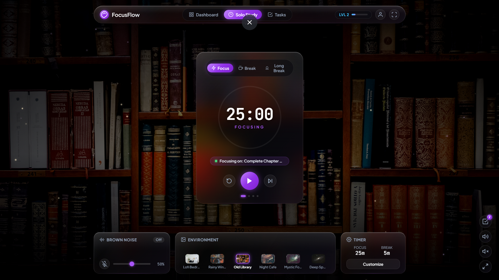
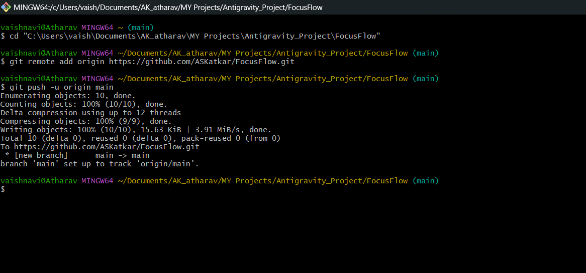
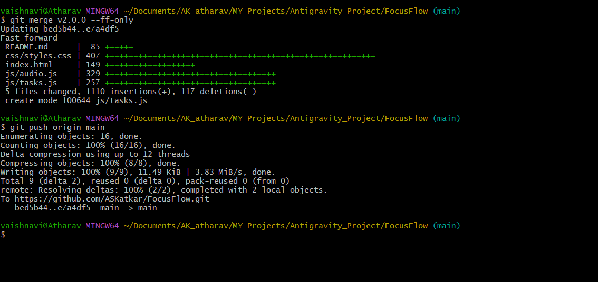
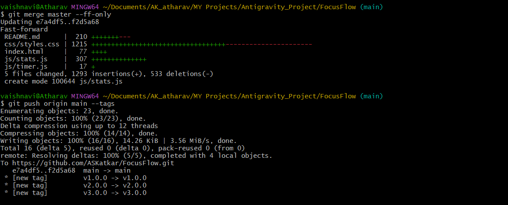

# 🌌 FocusFlow — Virtual Study Room

> **FocusFlow** is an aesthetic, distraction-free virtual study room and productivity workspace designed for deep focus. It combines a customizable Pomodoro timer, procedural ambient soundscapes, a lofi beats player, interactive focus checklists, and detailed study analytics within an atmospheric, dark glassmorphic environment.

---

## 📸 Complete Screenshots & Visual Evidence Showcase

All project screenshots are archived in the [`/assets`](./assets/) directory and showcased below:

| # | File Name | Type | Description |
| :-: | :--- | :--- | :--- |
| 1 | [`app-preview.png`](./assets/app-preview.png) | 🖥️ App Preview | Full Liquid Glass Workspace Interface & Deep Space Scene |
| 2 | [`terminal-v1.png`](./assets/terminal-v1.png) | 💻 Terminal Log | **Version 1.0.0** Git Push Verification |
| 3 | [`terminal-v2.png`](./assets/terminal-v2.png) | 💻 Terminal Log | **Version 2.0.0** Git Push Verification (Audio & Tasks) |
| 4 | [`terminal-v3.png`](./assets/terminal-v3.png) | 💻 Terminal Log | **Version 3.0.0** Git Push Verification (Stats & Dashboard) |

---

### 🖥️ 1. Website Workspace Interface


---

### 🟢 2. Version 1 Terminal Push Evidence


---

### 🟡 3. Version 2 Terminal Push Evidence


---

### 🟣 4. Version 3 Terminal Push Evidence


---

## 🚀 Version Evolution & Release Roadmap

FocusFlow was built and delivered in 3 progressive, feature-packed versions:

| Version | Milestone Release | Key Features Added | Git Release Tag |
| :---: | :--- | :--- | :---: |
| **`v1.0.0`** | **Core Timer & Workspace** | Pomodoro state engine (25/5/15m), SVG circular progress dial, Web Audio harmonic chime alerts, cozy library room, canvas dust motes, customizable timer durations modal. | [`v1.0.0`](#version-100--core-timer--workspace) |
| **`v2.0.0`** | **Audio & Tasks** | Multi-track ambient sound mixer (Brown, White, Rain noise), Lofi beats player, 6-theme environment switcher, interactive task checklist drawer, active focus pinning. | [`v2.0.0`](#version-200--ambient-soundscapes--focus-tasks) |
| **`v3.0.0`** | **Analytics & Gamification** | Productivity analytics dashboard, daily study streaks, 7-day weekly activity bar chart, session history logger, dynamic XP & leveling system (`LVL 1` to `LVL 2+`). | [`v3.0.0`](#version-300--study-statistics--gamification) |

## 🎧 Focus Music & Brainwave Sound Lab (Upgrade)

The workspace includes a dedicated scientific audio suite engineered specifically for studying, reading, and deep concentration:

* **🎶 Curated 10 Focus & Study Music Tracks**:
  1. *Midnight Study Session* — Mellow Rhodes & boom-bap rhythm for flow state.
  2. *Rain & Nostalgia Lofi* — Soft vinyl texture with relaxing acoustic keys.
  3. *Peaceful Study Piano Solo* — Gentle classical acoustic piano for writing and reading.
  4. *Late Night Coding Grooves* — Downtempo synth pads to prevent cognitive fatigue.
  5. *Coffee Shop Study Session* — Warm acoustic guitar and cozy cafe vibes.
  6. *Deep Cosmos Meditation & Flow* — Ethereal cosmic ambient pads for deep logic.
  7. *Morning Sun Acoustic Guitar* — Calming fingerstyle guitar for literature tasks.
  8. *Floating Clouds Piano & Strings* — Airy piano swells and ambient strings for exam focus.
  9. *Zen Garden Bamboo Flute* — Traditional flute and bells for mental serenity.
  10. *Sunset Study Chillhop* — Smooth rhythmic drums with vinyl warmth.
* **🧠 Scientific Binaural Beats Synthesizer (Web Audio API)**:
  * **Alpha Waves (10 Hz)** — Relaxed alertness, optimal memory consolidation & reading comprehension.
  * **Beta Waves (18 Hz)** — High focus, complex logic, mathematics, coding, and problem-solving.
  * **Theta Waves (6 Hz)** — Deep flow state, creative brainstorms, writing, and anxiety relief.
  * **528 Hz Solfeggio Tone** — Harmonic clarity frequency for clearing mental fog.
* **⏭️ Quick Track Skip Controls**: Dedicated Previous and Next buttons directly on the bottom dock for effortless song switching.
* **📊 Animated Audio Equalizer**: Dynamic 4-bar glowing purple visualizer dancing in the dock player whenever audio is active.
* **🌿 Layered Multi-Track Mixing**: Blend background ambient sounds (Brown Noise, Window Rain, Fireplace Crackle) concurrently on top of your study music!

---

## 📦 Detailed Version Feature Breakdown

### Version 1.0.0 — Core Timer & Workspace
* **⏱️ Pomodoro Engine**:
  * **Focus Period**: 25-minute default focus block.
  * **Short Break**: 5-minute restorative interval.
  * **Long Break**: 15-minute extended recovery after 4 full cycles.
* **⭕ Circular SVG Progress Ring**:
  * Precision stroke-dashoffset SVG countdown tracking with a glowing purple accent.
* **🔔 Procedural Harmonic Chime**:
  * Synthesized Tibetan singing bowl alert tone using the native **Web Audio API** (guaranteed zero download lag or missing audio files).
* **✨ Ambient Canvas Particles**:
  * High-performance HTML5 Canvas rendering gentle dust motes drifting across sunlight rays.
* **⚙️ Duration Customizer**:
  * Modal dialog permitting custom minutes for focus, short breaks, and long breaks with auto-start progression.

---

### Version 2.0.0 — Ambient Soundscapes & Focus Tasks
* **📋 Slide-out Task Management Drawer**:
  * Create, check off, and delete study goals and assignments.
  * **Active Focus Pinning**: Pin any task to prominently display it right beneath the countdown timer (`Focusing on: ...`).
  * Filter tasks by *All*, *Active*, or *Completed*, accompanied by a real-time pending task counter badge.
* **🎧 Multi-Track Ambient Sound Mixer**:
  * **Deep Brown Noise**: Procedural low-frequency Brownian noise to drown out conversational distractions.
  * **Pure White Noise**: Calming waterfall frequency hiss.
  * **Rainy Windowpane**: Procedural soft rain droplets against window glass via bandpass acoustic filters.
  * **Master Mute**: One-click instant audio silencer.
* **☕ Lofi Beats Player**:
  * Embedded streaming player featuring lo-fi study tracks with Play, Pause, and Track Skipping controls.
* **🖼️ Environment Switcher**:
  * 6 selectable immersive scenes with smooth visual crossfading:
    1. 📚 *Old Library* (Default warm sunlight scene)
    2. 🌧️ *Rainy Window*
    3. ☕ *Night Cafe*
    4. 🛏️ *Lofi Bedroom*
    5. 🌲 *Mystic Forest*
    6. 🌌 *Deep Space*

---

### Version 3.0.0 — Study Statistics & Gamification
* **📊 Productivity Analytics Dashboard**:
  * Opened seamlessly via the **Dashboard** navigation tab.
  * **Key Metrics Summary**:
    * 🔥 **Study Streak**: Tracks consecutive days of focus sessions.
    * ⏱️ **Today's Focus Time**: Total minutes focused today.
    * 📈 **All-Time Focus Time**: Cumulative minutes studied.
    * 🎯 **Sessions Completed**: Total count of completed focus blocks.
* **📅 7-Day Weekly Activity Bar Chart**:
  * Interactive CSS/SVG bar chart visualizing study duration per day with hover minute tooltips.
* **📜 Session History Logger**:
  * Chronological table showing completed sessions, durations, associated tasks, and exact timestamps. Includes a "Clear History" option.
* **🎮 Gamification & Leveling System**:
  * Dynamic **LVL** badge and progress bar in the top navigation bar.
  * Earn **2 XP** for every minute of focus work completed.
  * Level-up celebration toasts with audio fanfare when advancing to higher levels (`LVL 1 -> LVL 2`).
* **💾 Full Local Persistence**:
  * Timer preferences, tasks, active focus selections, session history, and XP survive browser restarts via `localStorage`.

---

## ⌨️ Keyboard Shortcuts

| Shortcut | Action |
| :---: | :--- |
| <kbd>Space</kbd> | Start / Pause countdown timer |
| <kbd>R</kbd> | Reset current session |
| <kbd>F</kbd> | Toggle Fullscreen distraction-free mode |

---

## 📂 Project Architecture

```text
FocusFlow/
├── index.html           # Semantic HTML5 single-page application structure
├── css/
│   └── styles.css       # Complete glassmorphism design system & animations
├── js/
│   ├── timer.js         # Pomodoro state machine, SVG dial, keyboard shortcuts
│   ├── audio.js         # Web Audio API multi-track noise synthesizer & lofi player
│   ├── tasks.js         # Interactive task checklist, filters, active focus pin
│   ├── stats.js         # Analytics metrics, streak logic, weekly chart & XP leveling
│   └── particles.js     # Canvas dust motes particle physics simulation
├── assets/              # Icons and graphics
└── README.md            # Master documentation, changelog, and setup guide
```

---

## 🛠️ How to Run Locally

FocusFlow requires **no build tools, no Node.js, and zero installation steps**:

### Option 1: Direct Browser Launch
1. Open the project directory:
   ```text
   C:\Users\vaish\Documents\AK_atharav\MY Projects\Antigravity_Project\FocusFlow
   ```
2. Double-click `index.html` to open it in Chrome, Edge, Firefox, or Safari.

### Option 2: Local HTTP Server (Optional)
If you prefer running through a local web server:
```bash
# Using Python
python -m http.server 8000

# Or using Node.js npx
npx serve
```
Then visit `http://localhost:8000` in your browser.

---

## 🌐 How to Push to GitHub & Deploy to GitHub Pages

To push your project to GitHub and deploy it online for free:

### 1. Create a Repository on GitHub
1. Go to [GitHub.com](https://github.com) and click **New Repository**.
2. Name it `FocusFlow` (keep it Public).
3. Do **not** initialize with a README (we already have our comprehensive README).

### 2. Push Your Local Git Repository
Run the following commands in PowerShell or your terminal inside the project folder:

```bash
cd "C:\Users\vaish\Documents\AK_atharav\MY Projects\Antigravity_Project\FocusFlow"

# 1. Rename default branch to main
git branch -M main

# 2. Add your GitHub remote (replace YOUR_USERNAME with your GitHub username)
git remote add origin https://github.com/YOUR_USERNAME/FocusFlow.git

# 3. Push all commits and version tags
git push -u origin main --tags
```

### 3. Enable 1-Click Free Hosting on GitHub Pages
1. On GitHub, open your repository's **Settings** tab.
2. In the left sidebar, click **Pages**.
3. Under **Build and deployment > Branch**, select `main` and `/ (root)`.
4. Click **Save**. Within 60 seconds, your site will be live at `https://YOUR_USERNAME.github.io/FocusFlow/`!

---

## 🌿 Complete Git Tag History

```text
* v3.0.0 — Release v3.0.0: Productivity stats dashboard, weekly activity chart, history logs, and level gamification
* v2.0.0 — Release v2.0.0: Ambient soundscapes mixer, Lofi beats player, environment switcher, and focus task list
* v1.0.0 — Release v1.0.0: Initial core Pomodoro timer, cozy library room, and glassmorphic UI
```

---

*Crafted with care for students, developers, and deep focus enthusiasts.*
